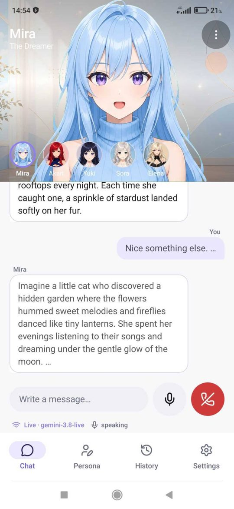
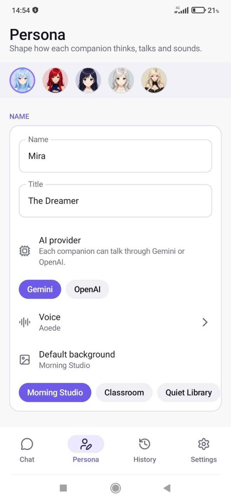
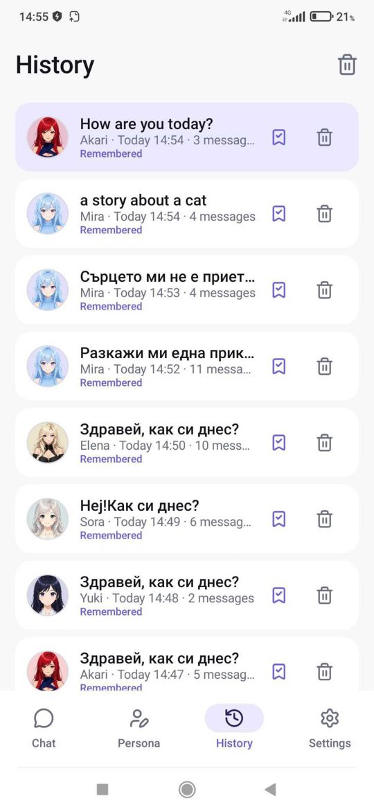
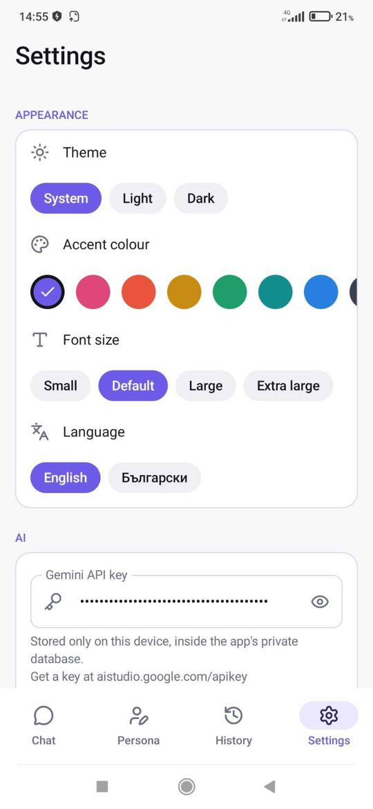

# WaifuVerse

A native Android (Kotlin + Jetpack Compose) voice companion app. Talk to anime
companions in any language through the **Gemini Live API** or the **OpenAI
Realtime API** (chosen per companion), with a lip-synced
character on screen, editable personalities, conversation memory and history.
Everything the app creates lives inside its own sandbox folder in a SQLite
database.

Target device: Xiaomi Redmi Note 8 Pro (1080 × 2340, 19.5:9), portrait only.
Minimum Android 8.0 (API 26), target API 35. Package: `com.vislupus.waifuverse`.

## Download

Ready-to-install APK:
**[WaifuVerse-1.0.0.apk](https://github.com/vislupus/WaifuVerse/raw/claude/charming-feynman-huabpw/releases/WaifuVerse-1.0.0.apk)**
(also in the `releases/` folder and on the
[Releases page](https://github.com/vislupus/WaifuVerse/releases) once published).
Open it on the phone, allow installation from this source, then add your
Gemini and/or OpenAI API key in *Settings*.

## Screenshots

| Chat | Persona | History | Settings |
|------|---------|---------|----------|
|  |  |  |  |

---

## Quick start

1. Install **Android Studio** (it includes the Android SDK and `adb`) and enable
   *USB debugging* on the phone.
2. Clone the repo and open the folder in Android Studio once (it downloads the
   Gradle wrapper and dependencies), **or** just run the commands below.
3. In the app: *Settings → Gemini API key* (https://aistudio.google.com/apikey)
   and/or *Settings → OpenAI API key* (https://platform.openai.com/api-keys).
   Each companion picks its provider on the *Persona* page.

### One-word commands

| Command        | What it does                                                      |
|----------------|-------------------------------------------------------------------|
| `make dev`     | build + install on the connected phone + launch + live logs       |
| `make run`     | build + install + launch                                          |
| `make build`   | compile a debug APK → `app/build/outputs/apk/debug/WaifuVerse-<version>-debug.apk` |
| `make release` | compile a release APK → `app/build/outputs/apk/release/WaifuVerse-<version>.apk` |
| `make publish` | build the release APK and publish it as a GitHub Release (needs the `gh` CLI) |
| `make watch`   | rebuild + reinstall + relaunch automatically on every file change |
| `make logs`    | show the app's log output                                         |
| `make preview` | open the project in Android Studio for Compose previews           |
| `make sprites` | regenerate character sprites from `tools/raw_sprites`             |
| `make icons`   | regenerate the Lucide icon file from `tools/lucide_svg`           |

The same scripts exist as `scripts/*.sh` (macOS/Linux/Git Bash) and
`scripts/*.ps1` (Windows PowerShell), e.g. `./scripts/dev.sh` or
`.\scripts\dev.ps1`. Plain Gradle works too: `./gradlew installDebug`.

### Publishing a release

Bump `versionCode` / `versionName` in `app/build.gradle.kts`, then either run
`make publish` (builds, tags, creates the GitHub Release and uploads the APK
through the `gh` CLI), or push a tag:

```
git tag v1.0.1
git push origin v1.0.1
```

The *Release APK* GitHub Actions workflow (`.github/workflows/release.yml`)
builds `WaifuVerse-<version>.apk`. It attaches the APK to the release only
when a signing keystore is stored in the repository secrets
(`KEYSTORE_BASE64`, `KEYSTORE_PASSWORD`, `KEY_ALIAS`, `KEY_PASSWORD`), so
that every release is signed with the same key and installs over the
previous version. Without the secrets, upload the APK built on your machine
(`make release`) to the release by hand. Locally you can sign with your own
key by setting the `WAIFUVERSE_KEYSTORE*` environment variables.

### Hot reload / previews

* **Live Edit** (true hot reload): in Android Studio run the app once
  (▶ or `make run`), then every edit to a Composable is pushed to the phone
  automatically. Enable it under *Settings → Editor → Live Edit* if it is off.
* **Compose previews** (no phone needed): open
  `app/src/main/java/com/vislupus/waifuverse/ui/Previews.kt` and click the
  *Split* / *Design* tab. Each screen has a preview in light/dark and in
  English/Bulgarian.
* **From the terminal**: `make watch` rebuilds and reinstalls on every change.

---

## Where to change things (the config files)

You should never need to dig through the code. Everything that controls
behaviour, looks, texts, characters and models is in
`app/src/main/java/com/vislupus/waifuverse/config/`:

| File                   | Controls                                                                                  |
|------------------------|-------------------------------------------------------------------------------------------|
| `AppConfig.kt`         | behaviour: defaults, storage paths, memory limits, lip-sync thresholds, animation, timeouts |
| `ThemeConfig.kt`       | accent colours, light/dark palettes, font sizes, radii, spacing, button sizes             |
| `TextsConfig.kt`       | every UI string, in English and Bulgarian (add a language here)                           |
| `CharactersConfig.kt`  | the waifus (name, title, voice, background, accent, personality), prompt template, rooms  |
| `ModelConfig.kt`       | Gemini and OpenAI model chains + fallbacks, voices, generation defaults, audio settings   |

Assets:

* `app/src/main/assets/characters/<id>/` – `body.webp`, `mouth_0..3.webp`,
  `sprite.json` (generated, see below)
* `app/src/main/assets/backgrounds/<id>.webp` – rooms
* `tools/raw_sprites/` – the original frames the generator starts from

User-changeable settings (theme, accent, font size, language, API key, model,
audio mode, memory default) are on the Settings page and stored in the
database. Their defaults come from the config files.

---

## Characters that do not jitter

The original mouth frames were generated as separate images and are shifted by
a few pixels relative to each other, so swapping whole frames made the
character "wobble". `tools/prepare_sprites.py` fixes this once, offline:

1. `mouth_0` becomes the static **body** image.
2. Every other frame is aligned to the body (best integer shift).
3. The mouth rectangle is detected as the only *solid* region that still
   differs after alignment (thin edge lines are eroded away).
4. That rectangle is cut from every aligned frame, its edges are feathered
   into the body, and saved as a small **mouth patch**.

At runtime the app draws the body once and only swaps the small patch, so
nothing except the mouth can move. The idle "breathing" animation moves body
and mouth together.

To add a character: put `mouth_0..3.webp` (transparent background, identical
size, closed → wide open) in `tools/raw_sprites/characters/<id>/`, run
`make sprites`, then add an entry in `CharactersConfig.kt`.

Requires `pip install pillow numpy`.

---

## Voice pipeline

* Two providers behind one `LiveSession` interface:
  * **Gemini Live**: microphone PCM16 16 kHz → `realtimeInput.audio`; models
    from `ModelConfig.MODEL_CHAIN` (`gemini-3.8-live` → `gemini-3.1-flash-live-preview` → …)
  * **OpenAI Realtime**: microphone PCM16 24 kHz → `input_audio_buffer.append`;
    models from `ModelConfig.OPENAI_MODEL_CHAIN` (`gpt-realtime-2` → `gpt-realtime-2.1` → `gpt-realtime-1.5` → …),
    server-side voice activity detection, transcription with `gpt-4o-mini-transcribe`.
    The temperature / top-p / top-k sliders apply to Gemini only.
* Provider → PCM16 24 kHz → `AudioTrack`; the loudness of what is *currently
  heard* drives the mouth frame (lip sync stays in sync with playback, not with
  network arrival)
* Models are tried in the order of the provider's chain. The first entry can
  be overridden from Settings. If a model is rejected the next one is used
  automatically and a notice appears in the chat.
* Interruptions: when you talk over her, playback is flushed instantly.
* Session resumption: when Gemini announces the session is ending
  (`goAway`), the app reconnects transparently with the resumption handle.
* Audio mode (Settings): **Voice call** uses the phone-call audio path with
  hardware echo cancellation (recommended hands-free); **Media** gives the
  highest-fidelity playback but has no echo cancellation, so the microphone
  is automatically muted while she speaks (half duplex, plus a short tail,
  `ModelConfig.MIC_UNMUTE_DELAY_MS`). You cannot interrupt her by voice in
  Media mode; tap the mic/call button instead.

## Memory and history

* Each chat is a *conversation*. **Remembered** conversations (bookmark icon on
  the stage) are injected as memory into every future session with the same
  companion (`AppConfig.MEMORY_MAX_MESSAGES` / `MEMORY_MAX_CHARS`).
* **Temporary** conversations are kept in History but never used as memory.
* Open any conversation from History to continue it — its transcript is
  re-sent as context.

## Storage

Everything is in the app's private files directory:
`/data/user/0/com.vislupus.waifuverse/files/data/waifuverse.db`
(SQLite: `settings`, `waifus`, `conversations`, `messages`). No external
storage is used. Uninstalling the app removes all data.

## Project layout

```
app/src/main/java/com/vislupus/waifuverse/
├─ config/        ← all tunables, texts, characters, models (edit these)
├─ data/          ← SQLite (AppDatabase), models, repository
├─ live/          ← Gemini Live websocket, audio in/out, session manager
├─ sprite/        ← sprite + background loader
├─ ui/
│  ├─ theme/      ← Material 3 theme built from ThemeConfig
│  ├─ icons/      ← Lucide icons as ImageVectors (generated)
│  ├─ components/ ← shared widgets, the character stage
│  ├─ screens/    ← Chat, Persona, History, Settings
│  ├─ AppRoot.kt  ← bottom navigation
│  └─ Previews.kt ← Android Studio previews
├─ MainViewModel.kt
├─ MainActivity.kt
└─ WaifuVerseApp.kt
tools/            ← prepare_sprites.py, lucide_to_kotlin.py, raw assets
scripts/          ← dev/run/build/watch/logs/preview scripts
```

## Icons

Icons are from [Lucide](https://lucide.dev) (ISC license), converted to
Compose `ImageVector`s by `tools/lucide_to_kotlin.py` so the app has no icon
dependency. To add an icon, drop its SVG into `tools/lucide_svg/` and run
`make icons`; it becomes `Lucide.<Name>`.
